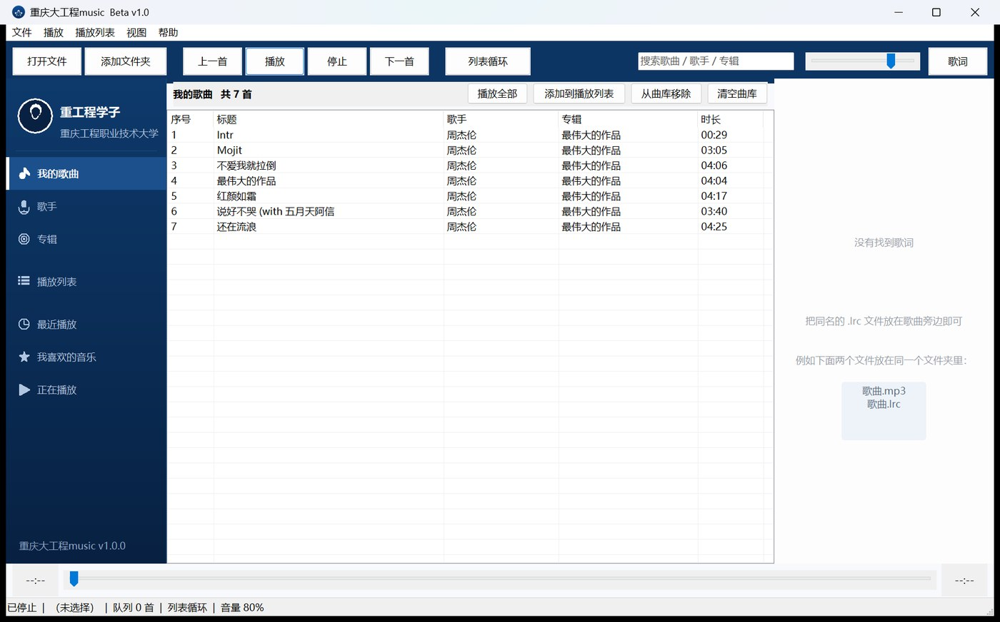
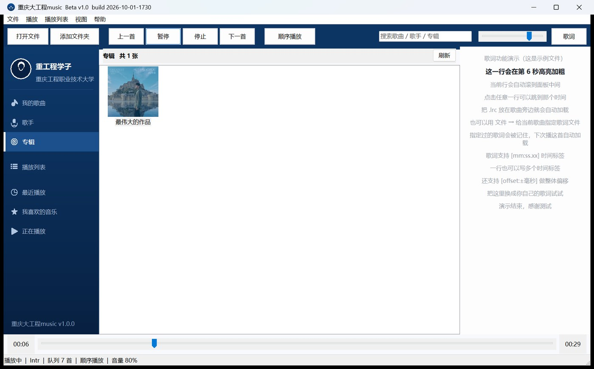

# 重庆大工程music

一个用 **纯 C 语言 + Win32 API** 从零写的本地音乐播放器。
面向校园场景：**只有一个 exe，不依赖任何运行库，拷到任何 Windows 上双击就能用。**



---

## ✨ 特点

- **零第三方依赖** —— 只调用系统自带 DLL，编译产物是单个 exe（约 1.1 MB）
- **免安装** —— 不需要安装程序，整个文件夹拷走就能跑
- **自绘界面** —— 侧栏、歌词面板、黑胶唱片播放页全部用 GDI 手绘，任意 DPI 都清晰
- **真实专辑封面** —— 从 MP3 的 ID3 标签里直接提取内嵌图片，不是占位图

---

## 🖼 截图

| 启动页 | 按专辑浏览 |
|---|---|
|  |  |

---

## 🎵 功能

| 模块 | 说明 |
|---|---|
| 曲库 | 扫描文件夹导入、读取 ID3 标签（歌名/歌手/专辑/时长）、持久保存 |
| 播放 | 顺序 / 列表循环 / 单曲循环 / 随机；暂停、进度拖动、音量调节 |
| 分组浏览 | 按歌手、按专辑自动归类，封面卡片网格，双击下钻 |
| 搜索 | 按歌名 / 歌手 / 专辑 / 文件名实时过滤 |
| 歌词 | 读取 `.lrc`，按时间轴同步高亮、自动滚动、点击任意一行跳到该时间；支持手动指定歌词文件并记住关联 |
| 播放列表 | 新建 / 重命名 / 删除，导入导出标准 m3u |
| 最近播放 | 记录播放次数与最后播放时间 |
| 我喜欢 | 收藏歌曲，独立持久化 |

---

## 🔧 技术实现

### 音频链路

`IMFSourceReader`（Media Foundation）解码 → 16 位 PCM → `waveOut` 输出。
解码跑在**独立的 MTA 线程**上，UI 线程只通过 `volatile LONG` + 事件对象交换状态。

> 最早用的是 MCI，但在目标机器上因 MP3 解码器未注册而失败，所以换成了 Media Foundation。

### 一切都是自己写的

| 能力 | 实现 |
|---|---|
| ID3 标签解析 | 手写，支持 v2.2 / v2.3 / v2.4 + v1 |
| MP3 时长计算 | 手写遍历 MPEG 帧头累加 |
| LRC 歌词解析 | 手写，支持多时间标签、`[offset:]`、UTF-8 / UTF-16 / GBK 自动识别 |
| 专辑封面提取 | 解析 ID3 的 APIC 帧，取出内嵌 JPEG |
| 图片解码 | Windows Imaging Component (WIC) |
| 音量控制 | WASAPI 会话音量（`ISimpleAudioVolume`） |

### 自绘黑胶唱片播放页

纯 GDI 手绘，不用任何图片资源：

- 唱片本体：深色圆盘 + 16 条同心纹路 + 边缘高光
- 中心标签：贴上**从 MP3 提取的真实专辑封面**，用 `SetWorldTransform` 绕圆心旋转
- 旋转动效：同心圆本身转起来看不出来，所以额外画一道跟随角度的高光扫过

---

## 🚀 编译

### 依赖

- Windows 10 / 11
- MinGW-w64（开发时用的是 GCC 11.5.0，任意较新的 MinGW-w64 都能编译）
- 系统自带库：`comctl32 winmm gdi32 user32 ole32 shell32 comdlg32 mfplat mfreadwrite mfuuid oleaut32 uuid msimg32 windowscodecs shlwapi`

### 编译

```bat
build.bat
```

产物：`MP3Player.exe`

`build.bat` 会自动按顺序找编译器：仓库根目录的 `mingw64\` → 系统 `PATH` → 常见安装位置（`C:\msys64\ucrt64`、`C:\msys64\mingw64`、`C:\mingw64` 等）。
如果你的 MinGW 装在别处，用记事本打开 `build.bat`，把开头的 `set "MINGW="` 改成你的 MinGW 根目录即可，**不用改别的地方**。

> 脚本结尾会停一下等你按键，方便双击运行时看结果；在 CI 或脚本里调用请加 `--no-pause`（或设环境变量 `CI=1`）。

也可以手动编译（和 `build.bat` 做的事一样）：

```bat
mkdir build
windres res\app.rc -o build\app_res.o -I res
gcc -O2 -g -Wall -Wextra -municode -mwindows -D_WIN32_WINNT=0x0601 ^
    -finput-charset=UTF-8 -fexec-charset=UTF-8 -Wl,--no-insert-timestamp ^
    src\main.c src\ui.c src\app.c src\playlist.c src\util.c ^
    src\tag_id3.c src\media_len.c src\store.c src\lrc.c ^
    src\theme.c src\cover.c src\wicdec.c src\nowplaying.c src\splash.c ^
    src\nav.c src\lyricview.c src\appvol.c src\crash.c ^
    src\selftest.c src\audio_mf.c build\app_res.o ^
    -o MP3Player.exe ^
    -lcomctl32 -lwinmm -lgdi32 -luser32 -lole32 -lshell32 -lcomdlg32 ^
    -lmfplat -lmfreadwrite -lmfuuid -loleaut32 -luuid -lmsimg32 ^
    -lwindowscodecs -lshlwapi
```

> `audio_mci.c` 是早期 MCI 实现，和 `audio_mf.c` 二选一，不参与上面这次编译。

---

## 📁 目录结构

```
├── src/            21 个 .c + 17 个 .h
│   ├── main.c        入口、窗口创建、菜单、自检
│   ├── app.c         应用状态、曲库、播放控制
│   ├── ui.c          主窗口、列表、封面卡片
│   ├── audio_mf.c    Media Foundation 解码 + waveOut
│   ├── audio_mci.c   早期 MCI 实现，保留作对照，不参与编译
│   ├── tag_id3.c     ID3 标签与封面提取
│   ├── wicdec.c      WIC 图片解码
│   ├── lrc.c         LRC 歌词解析
│   ├── nowplaying.c  自绘黑胶唱片页
│   ├── lyricview.c   自绘歌词面板
│   ├── nav.c         自绘深蓝侧栏
│   ├── theme.c       配色与绘制工具
│   └── store.c       持久化（曲库/收藏/列表/设置）
├── res/            图标、启动页、清单、资源脚本
├── tools/          辅助脚本（分析 MP3、生成测试音频、UI 自动化测试）
├── samples/        示例歌词文件
└── docs/screenshots/
```

---

## 📝 开发说明

这个项目是我在大一期间完成的第一个完整软件。**代码实现主要借助 AI Agent 协作完成**，
我负责的是需求定义、界面与交互设计、标准制定、问题定位和最终验收。

在开发过程中踩过的几个有代表性的坑：

| 问题 | 根因 | 解法 |
|---|---|---|
| 程序在 150% 缩放下发虚 | 清单里的 `dpiAware` 老写法在 Win11 不生效 | 改用 2016 命名空间 + 运行时 `SetProcessDPIAware()` |
| 封面整张隐形 | `StretchBlt` 只搬 RGB **不写 alpha**，DIB 的 alpha 全 0，被 `ILC_COLOR32` 当全透明 | 输出改用 `GUID_WICPixelFormat32bppBGR`，由 WIC 保证 alpha=255 |
| 同一个 exe 在不同机器上表现不同 | `OleLoadPicture`（1996 年的接口）对 OLE 单元状态敏感 | 整体换成 WIC 解码 |
| 顶部工具栏改不成深色 | 主窗口 `WM_ERASEBKGND` 与类背景刷都无效 | 建专用子窗口画底色，且必须先于按钮创建 |

---

## 📄 许可证

[MIT](LICENSE)

## 🙏 致谢

- 校徽视觉元素取自重庆工程职业技术大学
- 开发过程使用 AI Agent 协作，在此如实说明
